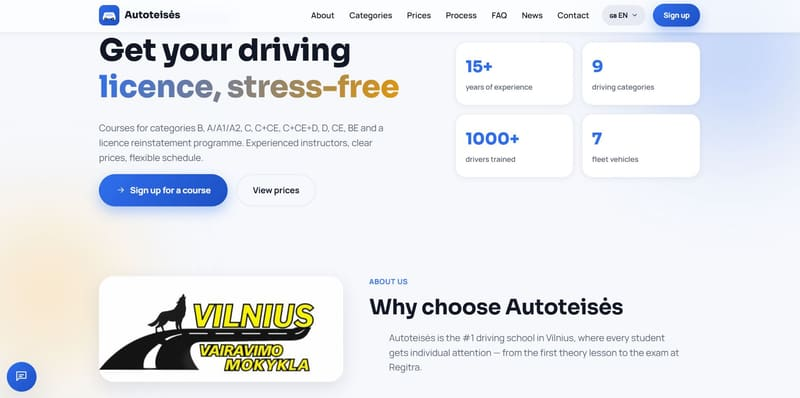
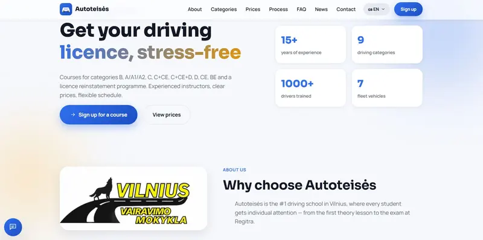
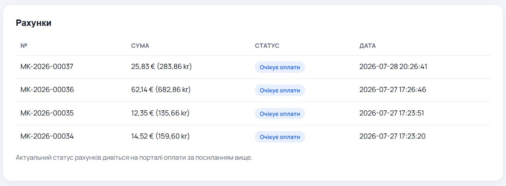
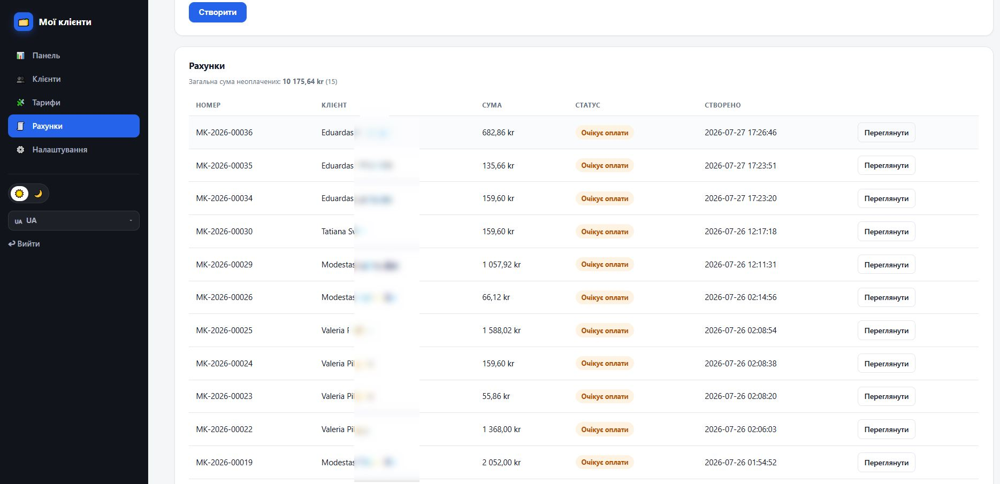
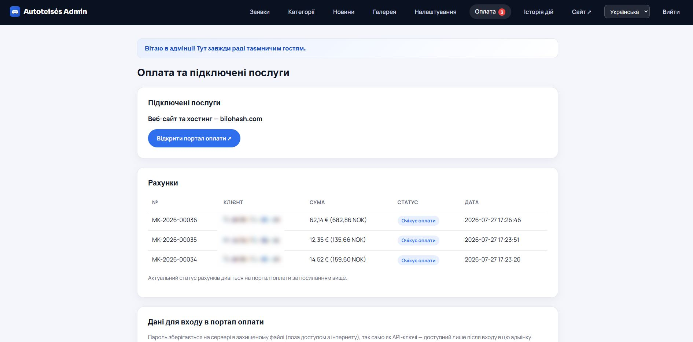

# Driving School CMS

**Full PHP product for driving schools (trafikkskoler / автошколи): public SEO site, licence categories B–CE, district pages, lead forms, news, gallery, NOK prices, Schema.org DrivingSchool, and a complete admin panel.**

| | |
|---|---|
| **Live landing** | https://bilohash.com/driving-school/ |
| **Live demo** | https://bilohash.com/driving-school/cms/ |
| **Admin demo** | https://bilohash.com/driving-school/cms/admin/login.php |
| **Version** | **1.0.0** |
| **Author** | [BILOHASH](https://bilohash.com/) · [Ruslan Bilohash](https://github.com/Ruslan-Bilohash) |
| **Donate / Support** | https://bilohash.com/donate.php |
| **License** | See repository (demo portfolio product) |

### Read this in other languages
- [English (this file)](README.md)
- [Українська](readme-ua.md)
- [Русский](readme-ru.md)
- [Norsk](readme-no.md)
- [Lietuvių](readme-lt.md)

---

## Screenshots

| Landing | Categories | District SEO |
|:---:|:---:|:---:|
|  |  |  |

| Admin | Leads | News AI |
|:---:|:---:|:---:|
|  |  |  |

Full set: [`screenshot/`](screenshot/) — also on the [live landing](https://bilohash.com/driving-school/#shots).

---

## What it does

**Driving School CMS** is a standalone PHP 8 application (JSON storage, no MySQL required) for driving schools that need a marketing site plus a simple admin back office.

### Public site
- **Home** — hero, categories, prices (NOK), FAQ, contact, CTAs
- **Licence categories** — B, A, BE, C, CE, CCE, D, lost licence recovery, etc.
- **District / area SEO pages** — local landing pages for organic search
- **News** — multi-language articles (public + admin editor)
- **Gallery** — photo gallery
- **Legal** — privacy & terms
- **Languages** — NO (demo default), EN, UK, RU (+ PL/SV shells where enabled)
- **SEO** — Schema.org `DrivingSchool`, sitemaps, robots, OG-friendly structure

### Admin panel
- **Dashboard** — overview
- **Leads / orders** — contact & callback pipeline
- **Categories** — content and pricing
- **News** — CRUD + optional AI assist hooks (keys empty in public demo)
- **Gallery** — media
- **Settings** — school info, phones, hours, billing portal link
- **Activity log** — admin actions
- **Payment** — demo billing notes / client portal link (no live API keys in repo)

### Landing page (`/driving-school/`)
- Product marketing page with multi-lang copy
- Feature / modules / Schema / screenshots / demo credentials
- Links to live CMS and admin

---

## Demo credentials

> Public **portfolio demo** only. Fictional school **Nordisk Trafikkskole** (Oslo). Not real services. Not real payments. **No API keys** in this repository.

| Role | URL | Login | Password |
|------|-----|-------|----------|
| Public demo | [/cms/](https://bilohash.com/driving-school/cms/) | — | — |
| Admin | [/cms/admin/login.php](https://bilohash.com/driving-school/cms/admin/login.php) | `demo` | `demo` |

---

## Requirements

- PHP **8.0+** (recommended 8.1+)
- Extensions: `json`, `mbstring`
- Writable `cms/inc/data/` for JSON storage
- Optional: `curl` / `openssl` if you enable AI or payment integrations later
- Web server: Apache or nginx
- **No database server required** (JSON files under `cms/inc/data/`)

---

## Quick install

1. Clone or download this repository.
2. Point the web server (or a path) to the project, e.g. `/driving-school/`.
3. Public CMS lives under `cms/` — default base path is `/driving-school/cms` (edit `cms/inc/config.php` for your path).
4. Ensure `cms/inc/data/` is writable.
5. Open the site and `/cms/admin/login.php`.
6. Change the admin password on any non-demo deployment.
7. Optional AI (OpenAI / Grok) and reCAPTCHA: set keys only in **Admin → Settings** on your server — **never commit secrets**.

```text
driving-school/
├── index.php                 # Product landing (SEO)
├── screenshot/               # UI screenshots
├── docs/screenshots/         # README images
├── assets/css/site.css
├── README.md                 # English (primary)
├── readme-ua.md / ru / no / lt
├── CHANGELOG.md
├── VERSION
└── cms/                      # Application
    ├── admin/                # Admin panel
    ├── api/                  # Contact / chat endpoints
    ├── assets/               # CSS, JS, images
    ├── en/ uk/ ru/ …         # Language routes
    ├── inc/                  # Core PHP + JSON data
    │   ├── config.php        # Paths, demo company (no secrets)
    │   └── data/             # settings, news, orders (demo)
    ├── index.php
    ├── sitemap.php
    └── VERSION
```

### Configure base path

In `cms/inc/config.php`:

```php
define('BASE_PATH', '/driving-school/cms');  // your URL path
define('SITE_URL', 'https://example.com/driving-school/cms');
```

---

## Capabilities (summary)

| Module | Capability |
|--------|------------|
| Categories | Licence classes, prices NOK, multi-lang content |
| Districts | Local SEO landing pages |
| Leads | Contact / callback forms → admin orders |
| News | Multi-lang posts, admin editor |
| Gallery | Image gallery |
| Admin | Settings, activity log, media uploads |
| SEO | Schema.org DrivingSchool, sitemap, multilingual URLs |
| Storage | JSON under `cms/inc/data/` |
| i18n | Public + admin UI (NO, EN, UK, RU, …) |

---

## Names by market

| Lang | Product name |
|------|----------------|
| EN | **Driving School CMS** |
| UK | **CMS автошколи** |
| RU | **CMS автошколы** |
| NO | **Kjøreskole CMS** |
| LT | **Vairavimo mokyklos CMS** |

---

## Security notes

- **No OpenAI / Grok / reCAPTCHA / payment secrets** in this GitHub repo (fields empty).
- Keep `cms/inc/data/` non-public if your server maps it under the docroot.
- Change demo admin password (`demo` / `demo`) on real installs.
- CSRF / session checks apply on admin forms.
- Public demo runs with `DS_DEMO_MODE` — real Telegram / payment side-effects disabled.

---

## Changelog & versions

- Full history: [CHANGELOG.md](CHANGELOG.md)
- Product version: [VERSION](VERSION) (mirrored in `cms/VERSION`)
- News article: https://bilohash.com/news/driving-school-cms.html

---

## Related

- **Donate / Support:** https://bilohash.com/donate.php  
- Ecosystem join: https://bilohash.com/ecosystem/join.php  
- Contact: https://bilohash.com/contact.php  
- News hub: https://bilohash.com/news/  
- Similar product: [My Clients](https://github.com/Ruslan-Bilohash/myclient)

---

## Disclaimer

This repository includes a **public portfolio demo**. The school **Nordisk Trafikkskole**, contacts, prices and leads are **fictional**. Do not use demo credentials or sample content as a real business identity. Configure your own company details and keys only on your private server.
