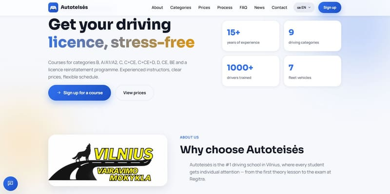
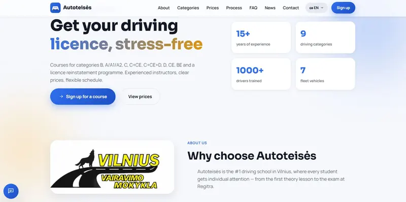
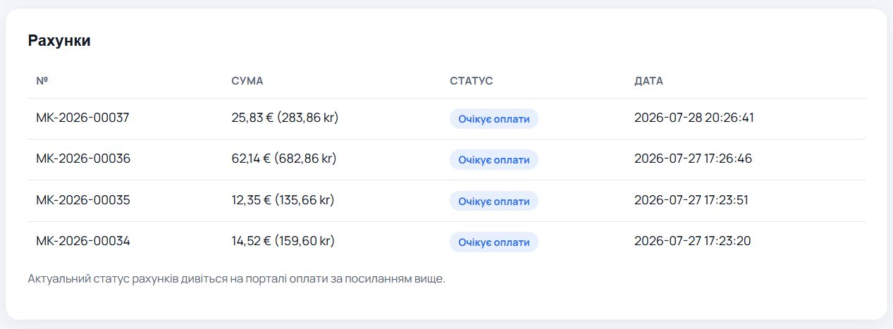
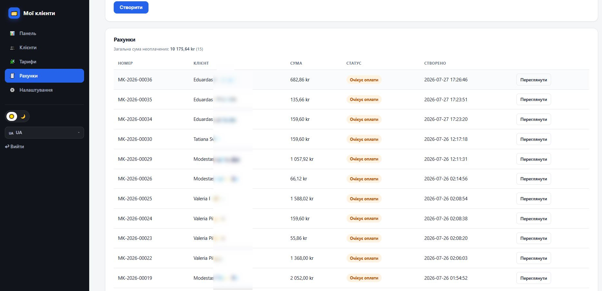
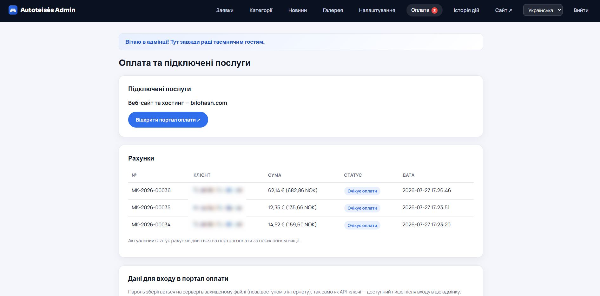

# Vairavimo mokyklos CMS (Driving School CMS)

**Pilnas PHP produktas vairavimo mokykloms: SEO svetainė, teisių kategorijos B–CE, rajonų puslapiai, užklausos, naujienos, galerija, kainos NOK, Schema.org DrivingSchool ir admin panelė.**

| | |
|---|---|
| **Landing** | https://bilohash.com/driving-school/ |
| **Live demo** | https://bilohash.com/driving-school/cms/ |
| **Admin** | https://bilohash.com/driving-school/cms/admin/login.php |
| **Versija** | **1.0.0** |
| **Autorius** | [BILOHASH](https://bilohash.com/) · [Ruslan Bilohash](https://github.com/Ruslan-Bilohash) |
| **Parama** | https://bilohash.com/donate.php |

### Kitomis kalbomis
- [English (primary)](README.md)
- [Українська](readme-ua.md)
- [Русский](readme-ru.md)
- [Norsk](readme-no.md)
- [Lietuvių (šis failas)](readme-lt.md)

---

## Ekrano nuotraukos

| Landing | Kategorijos | Rajonų SEO |
|:---:|:---:|:---:|
|  |  |  |

| Admin | Užklausos | Naujienos |
|:---:|:---:|:---:|
|  |  |  |

Visas rinkinys: [`screenshot/`](screenshot/).

---

## Ką daro produktas

Lengva PHP 8 programa (JSON, **be MySQL**) vairavimo mokykloms: vieša SEO svetainė + admin.

### Vieša svetainė
- Pagrindinis, kategorijos, NOK kainos, DUK, kontaktai
- Rajonų SEO puslapiai, naujienos, galerija
- Kalbos: NO (demo numatytoji), EN, UK, RU
- Schema.org DrivingSchool, sitemap

### Admin
- Užklausos, kategorijos, naujienos, galerija, nustatymai
- AI / reCAPTCHA laukai **tušti repozitorijoje**

---

## Demo

> Tik **portfelio demo**. Mokykla **Nordisk Trafikkskole** (Oslo) — fiktyvi. **Be API raktų** šiame repozitorijoje.

| Rolė | URL | Prisijungimas | Slaptažodis |
|------|-----|---------------|-------------|
| Svetainė | [/cms/](https://bilohash.com/driving-school/cms/) | — | — |
| Admin | [/cms/admin/login.php](https://bilohash.com/driving-school/cms/admin/login.php) | `demo` | `demo` |

---

## Reikalavimai

- PHP **8.0+**, `json`, `mbstring`
- Rašymo teisės į `cms/inc/data/`
- Duomenų bazės serverio nereikia

---

## Diegimas

1. Įkelkite repozitoriją.
2. CMS yra `cms/`.
3. Nustatykite `BASE_PATH` ir `SITE_URL` faile `cms/inc/config.php`.
4. Užtikrinkite rašymą į `cms/inc/data/`.
5. Pakeiskite admin slaptažodį realioje aplinkoje.
6. API raktus laikykite tik Admin → Settings — **niekada git**.

---

## Galimybės

| Modulis | Funkcija |
|---------|----------|
| Kategorijos | Teisių klasės, NOK |
| Rajonai | Vietinis SEO |
| Užklausos | Formos → admin |
| Naujienos | Daugiakalbės |
| SEO | Schema, sitemap |
| Saugykla | JSON |

---

## Sauga

GitHub **neturi** OpenAI / Grok / reCAPTCHA / mokėjimų paslapčių. Pakeiskite `demo`/`demo` produkcijoje.

---

## Changelog

- [CHANGELOG.md](CHANGELOG.md) · [VERSION](VERSION)

---

## Atsakomybės apribojimas

Demo duomenys fiktyvūs ir neskirti kaip tikros įmonės rekvizitai.
