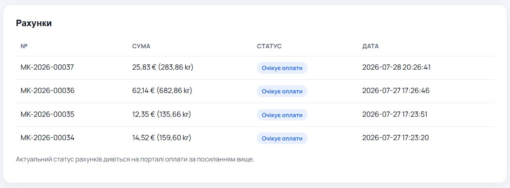
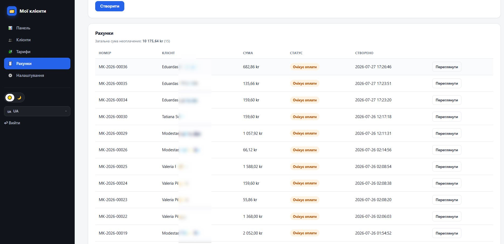
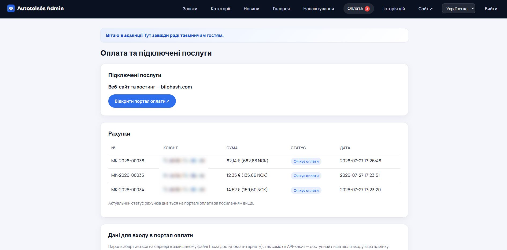

# Kjøreskole CMS (Driving School CMS)

**Full PHP-produkt for trafikkskoler: SEO-nettsted, førerkortklasser B–CE, bydels-/områdesider, leads, nyheter, galleri, priser i NOK, Schema.org DrivingSchool og komplett adminpanel.**

| | |
|---|---|
| **Landing** | https://bilohash.com/driving-school/ |
| **Live demo** | https://bilohash.com/driving-school/cms/ |
| **Admin** | https://bilohash.com/driving-school/cms/admin/login.php |
| **Versjon** | **1.0.0** |
| **Forfatter** | [BILOHASH](https://bilohash.com/) · [Ruslan Bilohash](https://github.com/Ruslan-Bilohash) |
| **Donasjon** | https://bilohash.com/donate.php |

### Andre språk
- [English (primary)](README.md)
- [Українська](readme-ua.md)
- [Русский](readme-ru.md)
- [Norsk (denne filen)](readme-no.md)
- [Lietuvių](readme-lt.md)

---

## Skjermbilder

| Landing | Klasser | Bydel SEO |
|:---:|:---:|:---:|
|  |  |  |

| Admin | Leads | Nyheter |
|:---:|:---:|:---:|
|  |  |  |

Fullt sett: [`screenshot/`](screenshot/).

---

## Hva gjør produktet

Lett PHP 8-applikasjon (JSON, **uten MySQL**) for trafikkskoler: offentlig SEO-side + admin.

### Offentlig nettsted
- Forside, førerkortklasser, NOK-priser, FAQ, kontakt
- SEO-sider for områder/bydeler, nyheter, galleri
- Språk: NO (demo-standard), EN, UK, RU
- Schema.org DrivingSchool, sitemap

### Admin
- Leads, kategorier, nyheter, galleri, innstillinger, aktivitetslogg
- AI / reCAPTCHA-feltene er **tomme i repo**

---

## Demo

> Kun **porteføljedemo**. Skolen **Nordisk Trafikkskole** (Oslo) er fiktiv. **Ingen API-nøkler** i dette repoet.

| Rolle | URL | Bruker | Passord |
|-------|-----|--------|---------|
| Nettsted | [/cms/](https://bilohash.com/driving-school/cms/) | — | — |
| Admin | [/cms/admin/login.php](https://bilohash.com/driving-school/cms/admin/login.php) | `demo` | `demo` |

---

## Krav

- PHP **8.0+**, `json`, `mbstring`
- Skrivetilgang til `cms/inc/data/`
- Ingen databaseserver

---

## Installasjon

1. Last opp repository.
2. CMS ligger i `cms/`.
3. Sett `BASE_PATH` og `SITE_URL` i `cms/inc/config.php`.
4. Sørg for skrivetilgang til `cms/inc/data/`.
5. Bytt admin-passord på ekte installasjon.
6. API-nøkler bare i Admin → Settings — **aldri i git**.

---

## Funksjoner (kort)

| Modul | Funksjon |
|-------|----------|
| Kategorier | Klasser, NOK-priser |
| Områder | Lokal SEO |
| Leads | Skjema → admin |
| Nyheter | Flerspråklige innlegg |
| SEO | Schema, sitemap |
| Lagring | JSON |

---

## Sikkerhet

Ingen OpenAI / Grok / reCAPTCHA / betalingshemmeligheter i GitHub. Bytt `demo`/`demo` i produksjon.

---

## Changelog

- [CHANGELOG.md](CHANGELOG.md) · [VERSION](VERSION)

---

## Ansvarsfraskrivelse

Demo-data er fiktive og skal ikke brukes som ekte firmainformasjon.
