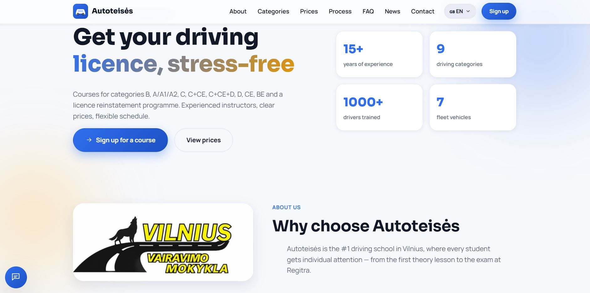
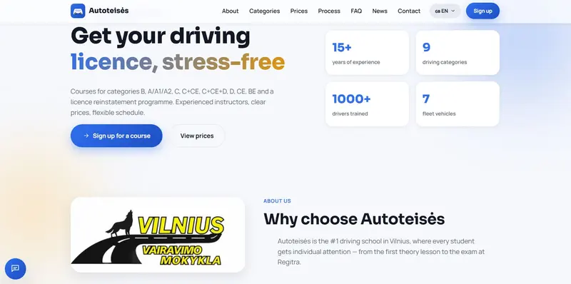
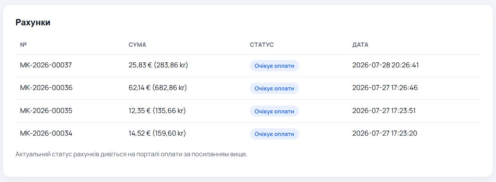
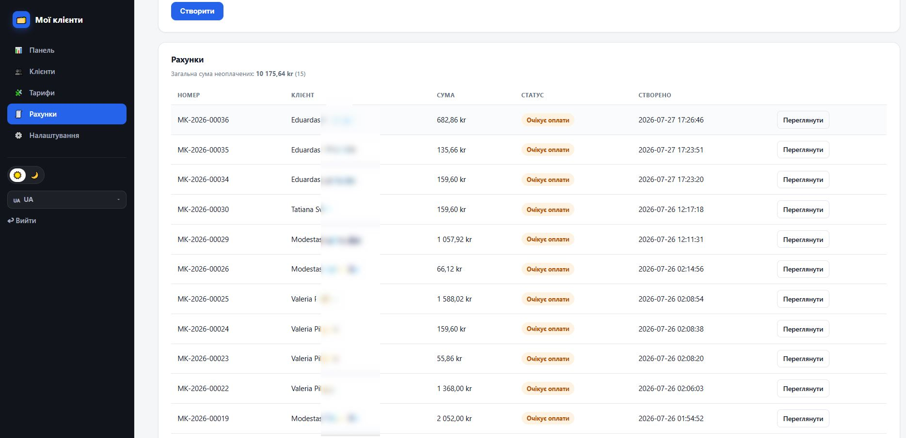
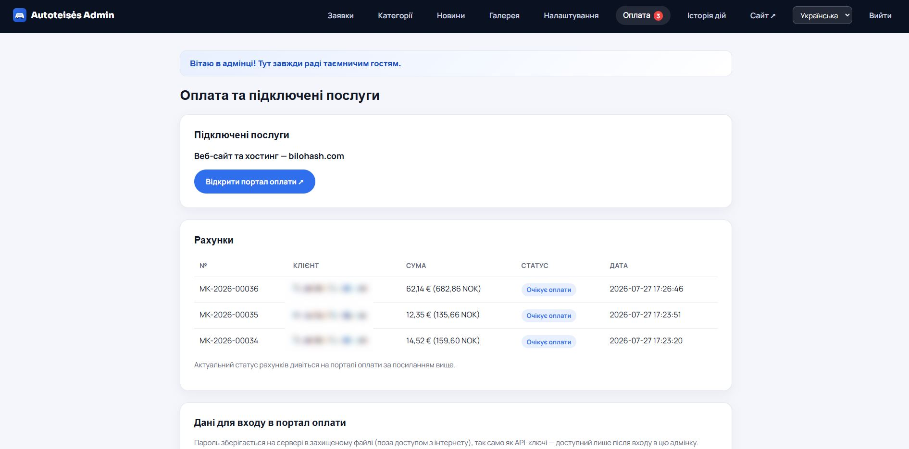

# CMS автошколы (Driving School CMS)

**Полный PHP-продукт для автошкол: SEO-сайт, категории прав B–CE, страницы районов, заявки, новости, галерея, цены в NOK, Schema.org DrivingSchool и админ-панель.**

| | |
|---|---|
| **Лендинг** | https://bilohash.com/driving-school/ |
| **Live demo** | https://bilohash.com/driving-school/cms/ |
| **Админ** | https://bilohash.com/driving-school/cms/admin/login.php |
| **Версия** | **1.0.0** |
| **Автор** | [BILOHASH](https://bilohash.com/) · [Ruslan Bilohash](https://github.com/Ruslan-Bilohash) |
| **Донат** | https://bilohash.com/donate.php |

### Другие языки
- [English (primary)](README.md)
- [Українська](readme-ua.md)
- [Русский (этот файл)](readme-ru.md)
- [Norsk](readme-no.md)
- [Lietuvių](readme-lt.md)

---

## Скриншоты

| Лендинг | Категории | SEO районов |
|:---:|:---:|:---:|
|  |  |  |

| Админ | Заявки | Новости |
|:---:|:---:|:---:|
|  |  |  |

Полный набор: [`screenshot/`](screenshot/).

---

## Что делает продукт

Лёгкое PHP 8-приложение (JSON, **без MySQL**) для автошкол: публичный SEO-сайт + админка.

### Публичный сайт
- Главная, категории, цены NOK, FAQ, контакты
- SEO-страницы районов, новости, галерея
- Языки: NO (демо по умолчанию), EN, UK, RU
- Schema.org DrivingSchool, sitemap

### Админка
- Заявки, категории, новости, галерея, настройки, журнал
- Поля AI / reCAPTCHA **пустые в репозитории**

---

## Демо

> Только **портфолио-демо**. Школа **Nordisk Trafikkskole** (Осло) — вымышленная. **Без API-ключей** в репо.

| Роль | URL | Логин | Пароль |
|------|-----|-------|--------|
| Сайт | [/cms/](https://bilohash.com/driving-school/cms/) | — | — |
| Админ | [/cms/admin/login.php](https://bilohash.com/driving-school/cms/admin/login.php) | `demo` | `demo` |

---

## Требования

- PHP **8.0+**, `json`, `mbstring`
- Запись в `cms/inc/data/`
- Без сервера БД

---

## Установка

1. Загрузите репозиторий.
2. CMS в `cms/`.
3. Настройте `BASE_PATH` / `SITE_URL` в `cms/inc/config.php`.
4. Права на `cms/inc/data/`.
5. Смените пароль админа на боевом сервере.
6. Секреты AI / reCAPTCHA — только в Admin → Settings, **не в git**.

---

## Возможности

| Модуль | Возможность |
|--------|-------------|
| Категории | Классы прав, цены NOK |
| Районы | Локальное SEO |
| Заявки | Формы → админка |
| Новости | Мультиязычные статьи |
| SEO | Schema, sitemap, i18n |
| Хранение | JSON |

---

## Безопасность

В GitHub **нет** секретов OpenAI / Grok / reCAPTCHA / платежей. Смените `demo`/`demo` на реальном деплое.

---

## Changelog

- [CHANGELOG.md](CHANGELOG.md) · [VERSION](VERSION)

---

## Отказ

Демо-данные вымышлены и не являются реквизитами реального бизнеса.
