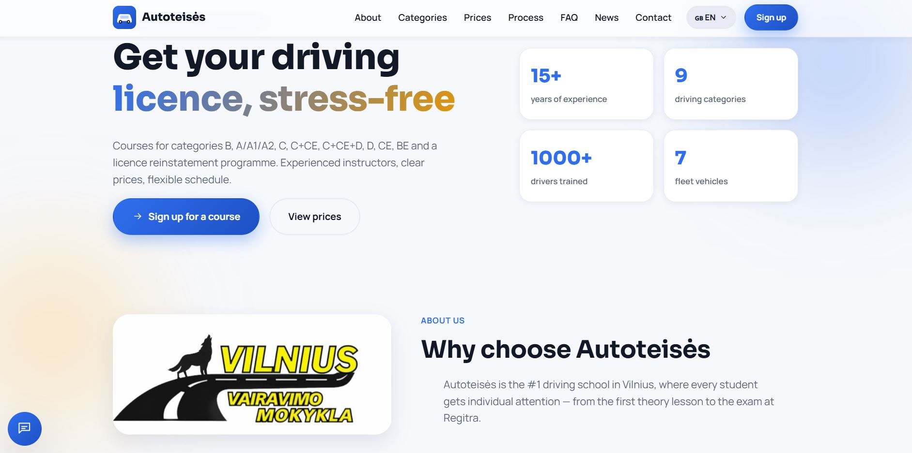
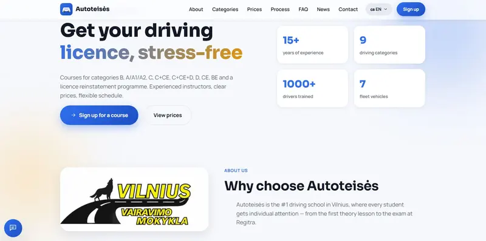
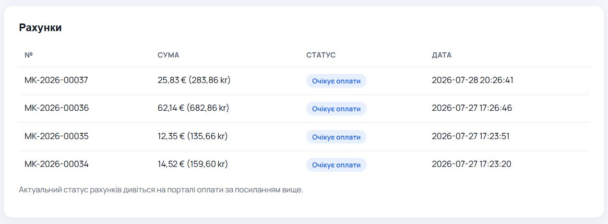
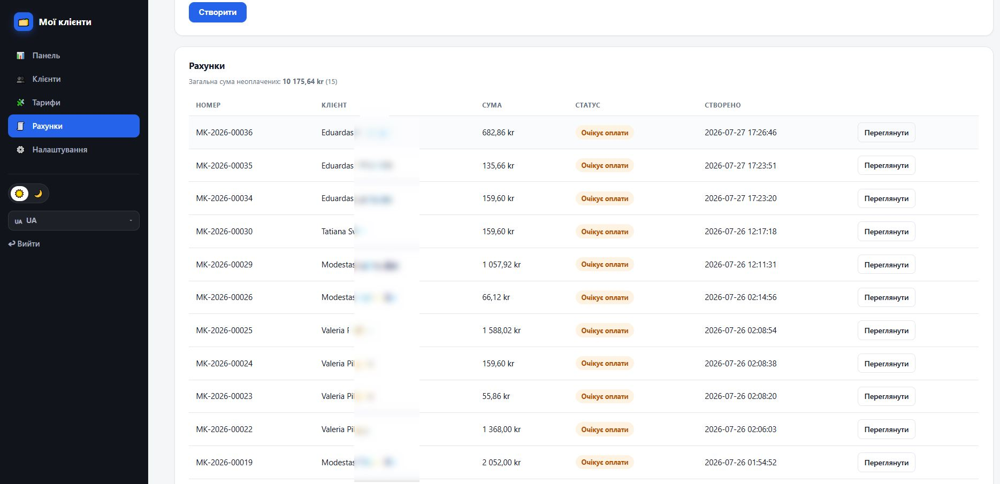
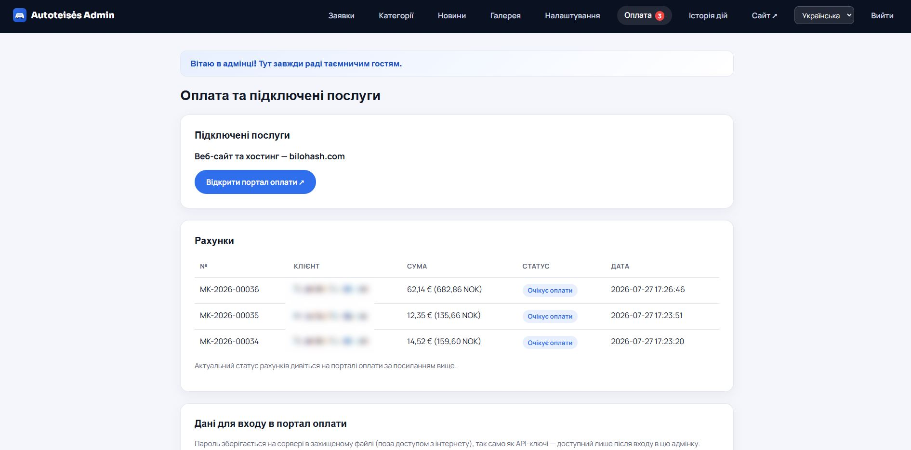

# CMS автошколи (Driving School CMS)

**Повний PHP-продукт для автошкіл (trafikkskoler): SEO-сайт, категорії водійських прав B–CE, сторінки районів, заявки, новини, галерея, ціни в NOK, Schema.org DrivingSchool і повна адмін-панель.**

| | |
|---|---|
| **Лендинг** | https://bilohash.com/driving-school/ |
| **Live demo** | https://bilohash.com/driving-school/cms/ |
| **Адмін** | https://bilohash.com/driving-school/cms/admin/login.php |
| **Версія** | **1.1.0** |
| **Автор** | [BILOHASH](https://bilohash.com/) · [Ruslan Bilohash](https://github.com/Ruslan-Bilohash) |
| **Донат / підтримка** | https://bilohash.com/donate.php |

### Іншими мовами
- [English (primary)](README.md)
- [Українська (цей файл)](readme-ua.md)
- [Русский](readme-ru.md)
- [Norsk](readme-no.md)
- [Lietuvių](readme-lt.md)

---

## Скріншоти

| Лендинг | Категорії | SEO районів |
|:---:|:---:|:---:|
|  |  |  |

| Адмін | Заявки | Новини |
|:---:|:---:|:---:|
|  |  |  |

Повний набір: [`screenshot/`](screenshot/).

---

## Що робить продукт

Легкий PHP 8 застосунок (JSON, **без MySQL**) для автошкіл: публічний SEO-сайт + адмінка.

### Публічний сайт
- Головна, категорії прав, ціни NOK, FAQ, контакти
- SEO-сторінки районів
- Новини (багатомовні), галерея, privacy/terms
- Мови: NO (демо за замовч.), EN, UK, RU
- Schema.org DrivingSchool, sitemap

### Адмінка
- Заявки (leads), категорії, новини, галерея
- Налаштування школи, журнал дій
- **Маркетинг** — звіт по каналах, джерелах і кампаніях заявок, UTM/реферер у кожній заявці,
  GA4 / Google Tag Manager / Meta Pixel (з урахуванням згоди на cookies), події конверсій,
  промо-банер, конструктор UTM-посилань, експорт CSV
- Поля AI / reCAPTCHA **порожні в репо** — ключі лише на вашому сервері

---

## Демо-доступ

> Лише **портфоліо-демо**. Школа **Nordisk Trafikkskole** (Осло) — вигадана. **Без API-ключів** у репозиторії.

| Роль | URL | Логін | Пароль |
|------|-----|-------|--------|
| Сайт | [/cms/](https://bilohash.com/driving-school/cms/) | — | — |
| Адмін | [/cms/admin/login.php](https://bilohash.com/driving-school/cms/admin/login.php) | `demo` | `demo` |

---

## Вимоги

- PHP **8.0+**
- `json`, `mbstring`
- Права запису на `cms/inc/data/`
- Apache або nginx
- База даних **не потрібна**

---

## Швидке встановлення

1. Завантажте репозиторій на хостинг.
2. CMS у каталозі `cms/`.
3. Відредагуйте `cms/inc/config.php` (`BASE_PATH`, `SITE_URL`).
4. Переконайтесь, що `cms/inc/data/` доступний для запису.
5. Відкрийте сайт і адмін-логін; **змініть пароль** на бойовому сервері.
6. Ключі AI / reCAPTCHA — лише в Admin → Settings, **ніколи в git**.

---

## Можливості (коротко)

| Модуль | Що є |
|--------|------|
| Категорії | Класи прав, ціни NOK, контент |
| Райони | Локальне SEO |
| Заявки | Форми → адмінка |
| Маркетинг | Статистика каналів і кампаній, UTM-атрибуція, GA4 / GTM / Meta Pixel, промо-банер, UTM-конструктор, CSV |
| Новини | Багатомовні статті |
| SEO | Schema, sitemap, i18n URL |
| Зберігання | JSON у `cms/inc/data/` |

---

## Безпека

- У GitHub **немає** секретів OpenAI / Grok / reCAPTCHA / платежів.
- Змініть `demo` / `demo` на реальному деплої.
- Не викладайте `data/` у відкритий лістинг.
- Маркетинг: у демо-режимі ID аналітики змінювати не можна, а посилання банера — лише на свій сайт.
  Якщо вмикаєте GA4 / GTM / Meta Pixel, оновіть тексти cookie-банера та політики конфіденційності
  (залиште «завантажувати трекери лише після згоди» для GDPR).

---

## Changelog

- [CHANGELOG.md](CHANGELOG.md)
- Версія: [VERSION](VERSION)

---

## Відмова від відповідальності

Демо-школа, контакти та ціни — **вигадані**. Не використовуйте демо-дані як реквізити реального бізнесу.
